# 🏎️ NXP Cup Autonomous Driving — MicroViT & Edge AI MLOps

<p align="center">
  
  
  
  
  
  
  
  
  
</p>

---

## 📌 Executive Summary

**NXP Cup Autonomous Driving** is an end-to-end autonomous scale 1:10 racing vehicle perception and control system. Developed for the international NXP Cup competition track at ENSICAEN (France), this project establishes an industrial-grade **Edge AI & MLOps** production platform.

We introduce **MicroViT**, an ultra-compact hybrid Convolutional-Vision Transformer architecture (**359,841 parameters**, **-77.4% smaller than NVIDIA DAVE-2**), combined with an online temporal smoother (**MicroViTSmoothed**: Median Filter $K=3$ + Exponential Moving Average $\alpha=0.65$).

Through hardware-aware compilation (**ONNX Runtime** and **NVIDIA TensorRT INT8**), the pipeline achieves sub-**2.2 ms** latency (**> 430 FPS**) on embedded edge hardware while demonstrating **+8.2% drift resilience** under harsh shadows and low-light variations (compared to **+76.9% error degradation in NVIDIA DAVE-2**).

---

## 🏁 Key Technical Innovations

1. **MicroViT-NXP (Hybrid Vision Transformer):**
   * Eliminates the inductive bias limitation of purely local $5 \times 5$ convolutions via dual-stage strided ConvStem ($16 \times 50 \times 64$) and Multi-Head Self-Attention ($d_{\text{model}}=128$, 4 heads, 2 blocks).
   * Encodes simultaneous spatial relations between left and right track guide markers across 200 spatial tokens.
2. **Deterministic Kinematic Auto-Labeling (3D Bird's Eye View):**
   * Multi-cue Canny + Black Top-Hat road segmentation transformed via Inverse Perspective Mapping (IPM).
   * Continuous steering target formulation based on **Stanley Cross-Track Error + Pure Pursuit Lookahead** ($\delta_{\text{next\_step}} \in [-30.0^\circ, +30.0^\circ]$), replacing coarse discrete classification.
3. **Hardware Acceleration & INT8 PTQ:**
   * Dynamic batch ONNX export with constant folding and graph simplification (`onnxsim`).
   * TensorRT INT8 quantization via `IInt8EntropyCalibrator2` consuming real track calibration frames.
4. **Online Temporal Post-Processing (`MicroViTSmoothed`):**
   * Hybrid stateful pipeline filtering single-frame lighting glitches and reducing servo jitter by **-75.0%** (1.95° vs. 7.82° in DAVE-2).
5. **Data Drift Auditing with Evidently AI:**
   * Automated statistical validation comparing nominal lighting vs. cast shadows and underexposure.
6. **Production Microservice & Multi-Stage Containerization:**
   * Asynchronous **FastAPI** inference service supporting multipart file uploads, base64 payloads, dynamic model switching, and health metrics.
   * Multi-stage minimal **Docker** container (< 250 MB) running as an unprivileged non-root user.

---

## 🏛️ System Architecture

```mermaid
flowchart TD
    subgraph INGESTION["1. Data Pipeline & Kinematics"]
        V[17 Raw MP4 Videos<br>ENSICAEN Track] -->|10.0 FPS Sampler| F[3,433 Canonical Frames<br>200x66x3 RGB]
        F --> IPM[Inverse Perspective Mapping<br>Bird's Eye View 400x400]
        IPM --> CTR[Stanley + Pure Pursuit<br>Centerline Extraction]
        CTR --> LBL[Continuous Labels<br>delta_next_step in -30 deg, +30 deg]
    end

    subgraph MODELS["2. Deep Learning Architectures"]
        LBL --> TRN[Training Pipeline<br>Huber Loss + Cosine LR]
        TRN --> M1["NVIDIA DAVE-2<br>(1,595,511 params)"]
        TRN --> M2["MicroViT Proposed<br>(359,841 params)"]
        M2 --> M3["MicroViTSmoothed<br>(Median K=3 + EMA alpha=0.65)"]
    end

    subgraph OPT["3. Edge Optimization"]
        M1 & M2 --> ONX[ONNX Dynamic Exporter<br>onnxsim + shape verification]
        ONX --> TRT[TensorRT INT8 PTQ<br>IInt8EntropyCalibrator2]
        TRT --> STRAT[Inference Strategy Pattern<br>PyTorch / ONNX / TensorRT]
    end

    subgraph SERVING["4. Production Serving & MLOps"]
        STRAT --> API[FastAPI Async Microservice<br>POST /steer | POST /steer/base64]
        API --> DOCKER[Multi-Stage Docker Container<br>python:3.12-slim-bookworm]
        F & STRAT --> EV[Evidently AI Drift Report<br>Nominal vs Cast Shadow]
        TRN --> MLF[MLflow Tracking Dashboard]
    end
```

---

## 🔬 MicroViT Neural Architecture

```mermaid
flowchart LR
    IN["Input Frame<br>(B, 3, 66, 200)"] --> STEM1["Conv2D 3x3, s=2<br>BatchNorm + GELU<br>(B, 32, 33, 100)"]
    STEM1 --> STEM2["Conv2D 3x3, s=2<br>BatchNorm + GELU<br>(B, 64, 16, 50)"]
    STEM2 --> PATCH["Patch Embedding 2x2<br>Linear Projection d=128<br>(B, 200 tokens, 128)"]
    PATCH --> POS["Learnable 1D<br>Positional Embedding"]
    POS --> BLK1["Transformer Block 1<br>LayerNorm + 4-Head Self-Attention<br>MLP Dim = 256 + Residuals"]
    BLK1 --> BLK2["Transformer Block 2<br>LayerNorm + 4-Head Self-Attention<br>MLP Dim = 256 + Residuals"]
    BLK2 --> GAP["Global Average Pooling<br>(B, 128)"]
    GAP --> HEAD["Linear Regressor<br>128 -> 32 -> 1"]
    HEAD --> OUT["Normalized Steer<br>y_hat in [-1.0, 1.0] -> [-30 deg, +30 deg]"]
    OUT --> SMOOTH["Online Median K=3<br>+ EMA alpha=0.65"]
    SMOOTH --> CTRL["PWM Servo Angle<br>(Smooth Trajectory)"]
```



---

## 📊 Comprehensive Benchmark & Empirical Results

The network architectures were evaluated on identical test splits and execution platforms:

| Architectural Metric / Model | NVIDIA DAVE-2 (2016) | MicroViT (Ours) | MicroViTSmoothed (Ours) |
| :--- | :---: | :---: | :---: |
| **Total Parameters** | 1,595,511 | **359,841** (*-77.4%*) | **359,841** (*-77.4%*) |
| **Model Footprint (ONNX)** | 6.09 MB | **1.39 MB** (*-77.2%*) | **1.39 MB** (*-77.2%*) |
| **Computational FLOPs** | 56.5 M | **31.2 M** (*-44.8%*) | **31.2 M** (*-44.8%*) |
| **Inference Latency P50** | **1.83 ms** | 2.16 ms | 2.18 ms |
| **Inference Latency P95** | 2.76 ms | 2.65 ms | 2.72 ms |
| **Inference Latency P99** | 3.82 ms | 3.48 ms | 3.55 ms |
| **Throughput (FPS)** | 482.9 FPS | 436.7 FPS | 437.0 FPS |
| **Nominal Test MAE** | 6.63° | 9.55° (*5.66° @ 50ep*) | 10.95° (*4.91° seq*) |
| **Drift Test MAE (Shadows)** | 11.73° (*+76.9%*) | 11.56° (*+21.1%*) | **11.85° (+8.2%)** |
| **Steering Jitter ($\sigma_{\Delta \delta}$)** | 7.82° | 6.88° | **1.95° (-75.0%)** |
| **Track Off-Course / Crashes** | 4 / 17 runs | 0 / 17 runs | **0 / 17 runs** |

> **Key Takeaway:** Under adverse cast shadows and underexposure (Evidently AI Data Drift simulation), convolutional architectures experience severe feature degradation (+76.9% error growth). MicroViT's global self-attention limits degradation to +21.1%, while `MicroViTSmoothed` achieves **+8.2% stability** and reduces steering servo jitter by **75.0%**, preventing high-frequency oscillations and track exits.

---

## 📁 Repository Structure

```text
nxpcup/
├── Makefile                                # Automated CLI tasks (test, lint, api, docker)
├── pyproject.toml                          # Project configuration & locked dependencies
├── recording_dataset/                      # 17 raw MP4 video runs (managed via DVC)
├── main/
│   ├── configs/
│   │   ├── models_config.yaml              # Architecture hyperparameters
│   │   └── train_config.yaml               # Training & optimizer hyperparameters
│   ├── data/
│   │   ├── auto_label_pipeline.py          # 10 FPS extraction & kinematic 3D labeling
│   │   ├── dataset.py                      # PyTorch Dataset with Albumentations
│   │   └── processed/                      # 3,433 images & continuous labels CSV
│   ├── docker/
│   │   ├── Dockerfile                      # Multi-stage production container
│   │   └── docker-compose.yml              # FastAPI API + MLflow UI stack
│   ├── src/
│   │   ├── api/
│   │   │   ├── app.py                      # FastAPI steering microservice
│   │   │   └── schemas.py                  # Pydantic request/response schemas
│   │   ├── inference/
│   │   │   ├── benchmark.py                # Statistical latency P50/P95/P99 profiler
│   │   │   └── strategy.py                 # Strategy Pattern (PyTorch, ONNX, TensorRT)
│   │   ├── models/
│   │   │   ├── dave2.py                    # Baseline NVIDIA DAVE-2
│   │   │   ├── factory.py                  # ModelFactory design pattern
│   │   │   ├── micro_vit.py                # MicroViT Transformer architecture
│   │   │   └── micro_vit_smoothed.py       # MicroViT with Median + EMA smoother
│   │   ├── monitoring/
│   │   │   └── drift_report.py             # Evidently AI Data Drift suite
│   │   ├── optimization/
│   │   │   ├── onnx_exporter.py            # Dynamic ONNX export & onnxsim
│   │   │   ├── trt_calibrator.py           # TensorRT IInt8EntropyCalibrator2
│   │   │   └── trt_compiler.py             # TensorRT execution engine builder
│   │   └── train.py                        # Unified training pipeline with MLflow
│   └── tests/
│       ├── test_api.py                     # FastAPI endpoint test suite
│       ├── test_auto_labeler.py            # Geometry & kinematic labeling tests
│       ├── test_dataset.py                 # Dataset & data augmentation tests
│       ├── test_drift.py                   # Data drift & feature extractor tests
│       ├── test_models.py                  # Forward/backward & parameter count tests
│       └── test_onnx.py                    # ONNX export & numerical parity tests
```

---

## ⚡ Quickstart Guide

### 1. Environment Installation
This project leverages [uv](https://github.com/astral-sh/uv) for deterministic dependency management:

```bash
# Clone the repository
git clone https://github.com/BPalhano/nxpcup.git
cd nxpcup

# Install dependencies and sync virtual environment
make install
```

### 2. Code Quality & Automated Tests
Ensure all automated unit tests, strict typechecking, and linting pass:

```bash
# Run full Pytest suite
make test

# Run Ruff linter and code formatter
make lint
make format

# Run strict Mypy typechecker across all source files
make typecheck
```

### 3. Model Training & MLflow Tracking
Train the steering architectures with Huber Loss and Cosine Annealing:

```bash
# Train MicroViT (Proposed Transformer)
make train-microvit

# Train NVIDIA DAVE-2 Baseline
make train-dave2
```

### 4. Edge Optimization (ONNX & TensorRT)
Export models to optimized ONNX computational graphs with batch dynamism:

```bash
# Export all models to main/models/*.onnx
make export-onnx

# Execute latency and throughput benchmarks (P50/P95/P99)
make benchmark
```

### 5. Data Drift Analysis (Evidently AI)
Generate the interactive HTML Data Drift report comparing sunny vs. shadowed laps:

```bash
# Run drift evaluation and save main/training_results/data_drift_report.html
make drift
```

---

## 🌐 Real-Time Steering API (FastAPI)

Launch the asynchronous steering service:

```bash
make api
# Uvicorn running on http://0.0.0.0:8000 (Documentation: http://localhost:8000/docs)
```

### Available Endpoints

| Method | Endpoint | Description |
| :--- | :--- | :--- |
| `GET` | `/health` | Service health status, active strategy, and cached models |
| `GET` | `/models` | List of supported model architectures |
| `POST` | `/steer` | Multipart form image upload (`image/jpeg`, `image/png`) |
| `POST` | `/steer/base64` | JSON payload with Base64-encoded image string |
| `POST` | `/reset` | Resets the online temporal buffer of `micro_vit_smoothed` |

### API Usage Examples

#### 1. Multipart Image Upload (`POST /steer`)
```bash
curl -X POST "http://127.0.0.1:8000/steer?model_name=micro_vit_smoothed" \
     -H "accept: application/json" \
     -H "Content-Type: multipart/form-data" \
     -F "file=@main/data/processed/images/WIN_20260202_15_54_34_Pro_frame_00100_200x66.jpg"
```

**Response:**
```json
{
  "status": "success",
  "model": "micro_vit_smoothed",
  "backend": "onnx",
  "steer_deg": 1.19,
  "steer_norm": 0.04,
  "raw_steer_deg": null,
  "inference_time_ms": 2.18,
  "timestamp": "2026-09-13T22:32:08.775005+00:00"
}
```

#### 2. Base64 JSON Payload (`POST /steer/base64`)
```bash
IMAGE_B64=$(base64 -w 0 main/data/processed/images/WIN_20260202_15_54_34_Pro_frame_00100_200x66.jpg)

curl -X POST "http://127.0.0.1:8000/steer/base64" \
     -H "Content-Type: application/json" \
     -d "{\"image_base64\": \"$IMAGE_B64\", \"model_name\": \"micro_vit\"}"
```

#### 3. Reset Online Filter State (`POST /reset`)
```bash
curl -X POST "http://127.0.0.1:8000/reset"
```

---

## 🐳 Docker Deployment

Build and run the lightweight production container:

```bash
# Build multi-stage Docker image
make docker-build

# Run container in background on port 8000
make docker-run

# Or launch full stack (FastAPI + MLflow Tracking UI)
make docker-compose-up
```

Access the services:
* **Inference API & Swagger UI:** `http://localhost:8000/docs`
* **MLflow Tracking Dashboard:** `http://localhost:5000`

---

## 👤 Author & Acknowledgments

* **Lead Engineer / Author:** Igor Braga Palhano
* **Institution:** ENSICAEN (École Nationale Supérieure d'Ingénieurs de Caen, France) & Universidade Federal do Ceará (UFC, Brazil)
* **Domain:** Autonomous Systems, Embedded Edge AI & MLOps

---

## 📜 License

This project is licensed under the [MIT License](LICENSE).
