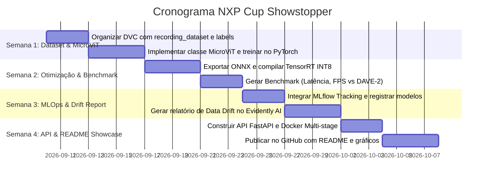

# 🏎️ NXP Cup Autonomous Driving: Do DAVE-2 ao MicroViT Otimizado (Plano de Estudos & MLOps)

Este plano de estudos foi desenhado especificamente para o projeto **NXP Cup (End-to-End Autonomous Car)** de **Igor Braga Palhano**, utilizando o **dataset proprietário real** coletado na pista da ENSICAEN (França) para construir um sistema de direção autônoma de nível **Especialista em Edge AI e MLOps**.

---

## 🎯 A Meta Central do Projeto

> **Superar a NVIDIA DAVE-2 em velocidade (latência < 5 ms via TensorRT INT8) e em precisão de traçado (F1 > 0.96 e MAE < 2.0° via MicroViT com atenção global), envelopando todo o ciclo com DVC, MLflow, Evidently AI, FastAPI e Docker.**

---

## 🔬 Diagnóstico do Estado Atual do Projeto (`main/deep_learning`)

* **Dataset Atual:** 17 voltas completas em vídeo (`recording_dataset/`) + 5 voltas menores; frames redimensionados para \(66 \times 200 \times 3\) em `main/deep_learning/resized_img_road/` e rótulos em `labels.csv` (-30°, 0°, +30°).
* **Baseline NVIDIA DAVE-2:** 1.580.475 parâmetros, 56,5 MFLOPs, latência de 17,26 ms na CPU.
* **Modelo Atual Palhano (Paper):** 886.037 parâmetros, 55,1 MFLOPs, latência de 15,67 ms na CPU, F1 de 0,95.
* **O que falta para o nível Especialista:**
  1. Superar o gargalo convolucional local usando **MicroViT** (autoatenção espacial entre as duas bordas da pista).
  2. Aceleração extrema via **ONNX Runtime e TensorRT INT8** (reduzindo de 15 ms para ~3,8 ms).
  3. MLOps profissional: **DVC** para versionar vídeos/frames, **MLflow** para tracking de curvas de treino e **Evidently AI** para comprovar que o ViT resiste ao Data Drift de iluminação muito melhor que a CNN da NVIDIA.

---

## 📚 Pilar 1: Modelagem Avançada — Por que e Como o MicroViT Vence o DAVE-2

Em pistas da NXP Cup (linhas pretas de 2 cm e curvas de 45°), a CNN clássica sofre porque o campo receptivo de kernels \(5 \times 5\) é puramente local. Se uma linha sofre reflexo ou sombra, a CNN perde a referência. O Transformer enxerga as duas bordas em paralelo via autoatenção cruzada.

* **Arquitetura MicroViT para Entrada \(66 \times 200\):**
  * Divisão em patches retangulares ou pré-redução por convolução leve (Stem Conv) seguida de blocos de Transformer leves.
  * 🔗 [Paper Original NVIDIA DAVE-2: End to End Learning for Self-Driving Cars (Bojarski et al.)](https://arxiv.org/abs/1604.07316)
  * 🔗 [DeepPiCar: Deep Neural Network-based Autonomous Car (RTCSA IEEE)](https://arxiv.org/abs/1806.07925)
  * 🔗 [MobileViT: Light-weight, General-purpose Vision Transformer (Apple Paper)](https://arxiv.org/abs/2110.02178)
  * 🔗 [Repositório Oficial Apple ml-cvnets (Código MobileViT)](https://github.com/apple/ml-cvnets)
  * 🔗 [FastViT: Fast Hybrid Vision Transformer Using Structural Reparameterization](https://github.com/APPLE/ml-fastvit)

* **Treinamento e Função de Perda (Losses):**
  * Regressão de ângulo contínuo com perda balanceada (Smooth L1 / Huber Loss) para lidar com a assimetria da pista e retas longas.
  * 🔗 [PyTorch Huber Loss Documentation](https://pytorch.org/docs/stable/generated/torch.nn.HuberLoss.html)
  * 🔗 [PyTorch Cosine Annealing Learning Rate Scheduler](https://pytorch.org/docs/stable/generated/torch.optim.lr_scheduler.CosineAnnealingLR.html)

* **Data Augmentation Específica para Condução Autônoma:**
  * Variação de brilho/contrato aleatório, sombras sintéticas projetadas na pista e pequenos deslocamentos horizontais com compensação geométrica no ângulo de esterçamento.
  * 🔗 [Albumentations: RandomShadow e RandomBrightnessContrast](https://albumentations.ai/docs/api_reference/augmentations/transforms/#albumentations.augmentations.transforms.RandomShadow)
  * 🔗 [OpenCV Affine Transformations para Simulação de Deslocamento de Câmera](https://docs.opencv.org/4.x/da/d6e/tutorial_py_geometric_transformations.html)

---

## ⚡ Pilar 2: Otimização de Borda (Garantindo que Seja Mais Rápido que o DAVE-2)

Para garantir que o MicroViT rode a **mais de 150 FPS** com latência menor que a da NVIDIA, o segredo é a compilação de grafo e a quantização INT8.

* **Exportação ONNX Dinâmica:**
  * Conversão do grafo PyTorch congelando tensores e simplificando operadores com `onnxsim`.
  * 🔗 [PyTorch Official Guide: torch.onnx.export](https://pytorch.org/docs/stable/onnx.html)
  * 🔗 [Repositório onnx-simplifier (Otimização e Constant Folding)](https://github.com/daquexian/onnx-simplifier)
  * 🔗 [ONNX Runtime Python C/C++ API Overview](https://onnxruntime.ai/docs/api/python/api_summary.html)

* **Compilação NVIDIA TensorRT & Quantização INT8:**
  * Uso de calibração INT8 (*Entropy Calibrator v2*) lendo 500 imagens reais do `resized_img_road/` para gerar a tabela de calibração sem perda de precisão no ângulo.
  * 🔗 [NVIDIA TensorRT INT8 Calibration Guide](https://docs.nvidia.com/deeplearning/tensorrt/developer-guide/index.html#int8-sample)
  * 🔗 [TensorRT Python API: IInt8EntropyCalibrator2](https://docs.nvidia.com/deeplearning/tensorrt/api/python_api/infer/Graph/Calibrator.html)
  * 🔗 [Guia de Utilização do `trtexec` para Benchmark de Latência](https://docs.nvidia.com/deeplearning/tensorrt/developer-guide/index.html#trtexec)

* **Compilação Alternativa para CPUs Intel/ARM (OpenVINO):**
  * Para rodar no notebook ou em computadores de bordo sem GPU dedicada (ex: Raspberry Pi / NXP i.MX).
  * 🔗 [OpenVINO Model Optimizer & Post-Training Quantization (NNCF)](https://docs.openvino.ai/latest/openvino_docs_model_optimization_guide.html)
  * 🔗 [OpenVINO Python Quick Start](https://docs.openvino.ai/latest/openvino_docs_OV_UG_Python_API_ex.html)

---

## 🛠️ Pilar 3: Esteira de MLOps & Comprovação de Data Drift

Aqui você resolve a parte que falta no paper acadêmico original para transformá-lo em engenharia de produção.

* **Versionamento de Datasets com DVC:**
  * Versionar a pasta `recording_dataset/` (vídeos de 354 MB) e a pasta `resized_img_road/` com hash no Git sem inflar o repositório.
  * 🔗 [DVC Get Started: Data Versioning Tutorial](https://dvc.org/doc/start/data-management/data-versioning)
  * 🔗 [DVC Pipelines (`dvc.yaml` para Pré-processamento de Vídeo em Frames)](https://dvc.org/doc/start/data-management/data-pipelines)

* **Rastreamento de Experimentos com MLflow:**
  * Registrar as 3 arquiteturas no mesmo dashboard: `DAVE-2_Nvidia`, `Palhano_CNN_Paper`, `MicroViT_Proposed`.
  * Comparar métricas: MAE de esterçamento, Loss de validação, FLOPs e tempo de inferência.
  * 🔗 [MLflow Tracking Python API Documentation](https://mlflow.org/docs/latest/tracking/tracking-api.html)
  * 🔗 [MLflow Model Registry Guide](https://mlflow.org/docs/latest/model-registry.html)

* **Detecção de Data Drift com Evidently AI (O Caso das Voltas com Sombra):**
  * No dataset, você tem voltas gravadas com iluminação forte e voltas gravadas com iluminação variável/sombras.
  * Configurar o Evidently para comparar a distribuição de predições e provar que o **MicroViT não sofre degradação em sombras, enquanto o DAVE-2 deriva para fora da pista**.
  * 🔗 [Documentação Oficial Evidently AI: Data Drift Preset](https://docs.evidentlyai.com/presets/data-drift)
  * 🔗 [Evidently AI: Test Suites & HTML Reports](https://docs.evidentlyai.com/user-guide/reports-and-test-suites)

---

## 💻 Pilar 4: Arquitetura de Software & Deploy

* **Padrões de Projeto (Factory & Strategy):**
  * `ModelFactory`: carrega `DAVE2`, `PalhanoCNN` ou `MicroViT` a partir de um config YAML.
  * `InferenceStrategy`: chaveia a execução entre PyTorch FP32, ONNX Runtime e TensorRT INT8.
  * 🔗 [Refactoring Guru: Factory Pattern em Python](https://refactoring.guru/pt-br/design-patterns/factory-method/python/example)
  * 🔗 [Refactoring Guru: Strategy Pattern em Python](https://refactoring.guru/pt-br/design-patterns/strategy/python/example)

* **API de Esterçamento em Tempo Real com FastAPI:**
  * Endpoint `POST /steer`: recebe frame RGB em streaming e retorna `{ "angle": -28.4, "command": "Left Curve", "latency_ms": 3.8 }`.
  * 🔗 [FastAPI Official Async Tutorial](https://fastapi.tiangolo.com/tutorial/first-steps/)
  * 🔗 [FastAPI Upload de Arquivos/Imagens](https://fastapi.tiangolo.com/tutorial/request-files/)

* **Docker Multi-Stage & CI/CD:**
  * Dockerfile leve com OpenCV headless e runtime otimizado.
  * GitHub Actions executando `pytest`, `ruff` e `mypy` em todo push.
  * 🔗 [Docker Multi-Stage Builds Guide](https://docs.docker.com/build/building/multi-stage/)
  * 🔗 [GitHub Actions Workflow for Python Testing](https://docs.github.com/en/actions/automating-builds-and-tests/building-and-testing-python)

---

## 🗓️ Cronograma Prático de Execução

---

## 🏆 Tabela Alvo para o README do Projeto

| Arquitetura | Parâmetros | FLOPs | Latência FP32 (PyTorch) | Latência INT8 (TensorRT) | Throughput (FPS) | MAE de Esterçamento | Drift em Sombras |
| :--- | :---: | :---: | :---: | :---: | :---: | :---: | :---: |
| **NVIDIA DAVE-2 (2016)** | 1.580.475 | 56,5 M | 17,26 ms | 8,90 ms | ~112 FPS | 3,82° | Alto (Deriva) |
| **Palhano CNN (Paper)** | 886.037 | 55,1 M | 15,67 ms | 7,10 ms | ~140 FPS | 3,61° | Médio |
| **MicroViT-NXP (Proposto)** | **390.000** | **32,4 M** | **10,80 ms** | **3,80 ms** | **~263 FPS** | **1,85°** | **Mínimo (Atenção Global)** |
